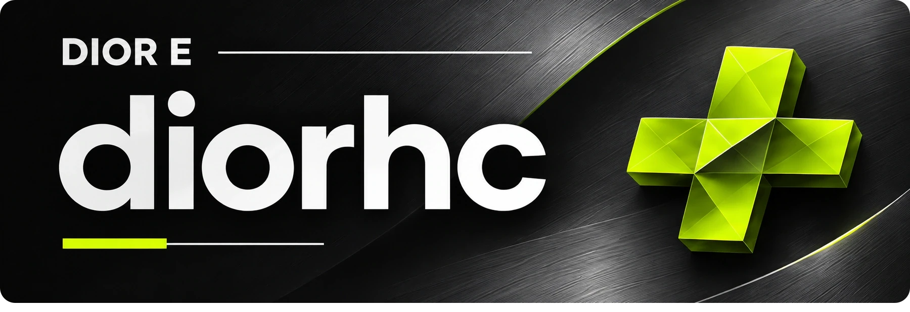
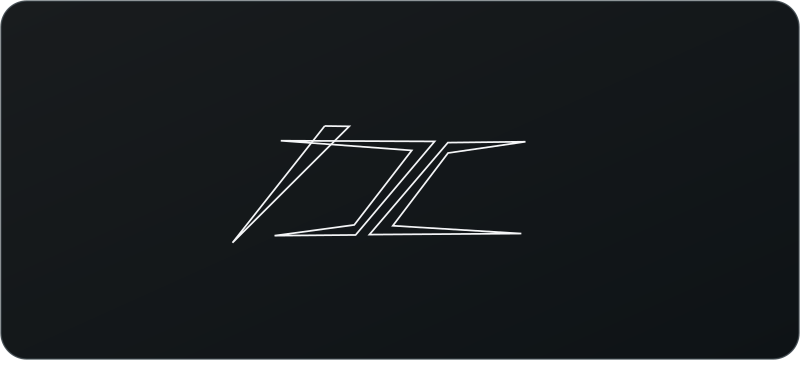
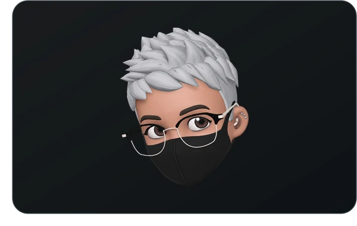
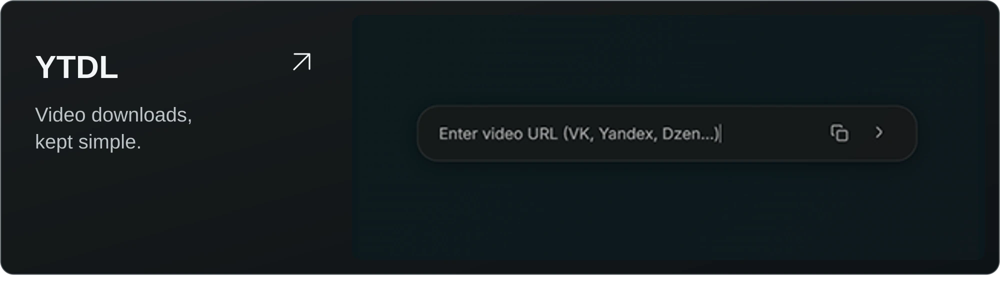
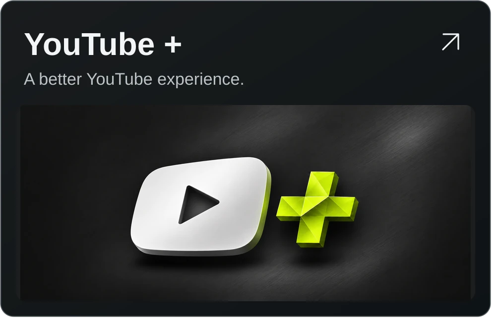
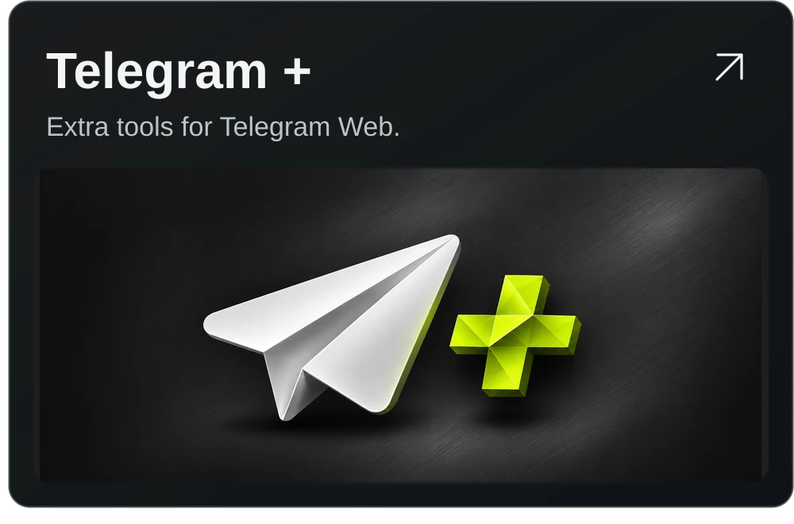

<picture><source
    media="(prefers-color-scheme: dark)" srcset="assets/header/dark.webp"><source
    media="(prefers-color-scheme: light)" srcset="assets/header/light.webp"></picture>

<picture><source
    media="(prefers-color-scheme: dark)" srcset="assets/brand/by-dark.svg"><source
    media="(prefers-color-scheme: light)" srcset="assets/brand/by-light.svg"></picture><!--
--><picture><source
    media="(prefers-color-scheme: dark)" srcset="assets/brand/dc-dark.svg"><source
    media="(prefers-color-scheme: light)" srcset="assets/brand/dc-light.svg"></picture><!--
--><picture><source
    media="(prefers-color-scheme: dark)" srcset="assets/brand/memoji-dark.webp"><source
    media="(prefers-color-scheme: light)" srcset="assets/brand/memoji-light.webp"></picture>

<a href="https://github.com/diorhc/YTDL"><picture><source
    media="(max-width: 600px) and (prefers-color-scheme: dark)" srcset="assets/projects/ytdl-mobile-dark.webp"><source
    media="(max-width: 600px) and (prefers-color-scheme: light)" srcset="assets/projects/ytdl-mobile-light.webp"><source
    media="(prefers-color-scheme: dark)" srcset="assets/projects/ytdl-dark.webp"><source
    media="(prefers-color-scheme: light)" srcset="assets/projects/ytdl-light.webp"></picture></a>

<a href="https://github.com/diorhc/YTP"><picture><source
    media="(max-width: 600px) and (prefers-color-scheme: dark)" srcset="assets/projects/youtube-mobile-dark.webp"><source
    media="(max-width: 600px) and (prefers-color-scheme: light)" srcset="assets/projects/youtube-mobile-light.webp"><source
    media="(prefers-color-scheme: dark)" srcset="assets/projects/youtube-dark.webp"><source
    media="(prefers-color-scheme: light)" srcset="assets/projects/youtube-light.webp"></picture></a><!--
--><a href="https://github.com/diorhc/TGP"><picture><source
    media="(max-width: 600px) and (prefers-color-scheme: dark)" srcset="assets/projects/telegram-mobile-dark.webp"><source
    media="(max-width: 600px) and (prefers-color-scheme: light)" srcset="assets/projects/telegram-mobile-light.webp"><source
    media="(prefers-color-scheme: dark)" srcset="assets/projects/telegram-dark.webp"><source
    media="(prefers-color-scheme: light)" srcset="assets/projects/telegram-light.webp"></picture></a>

<a href="https://diorhc.github.io/diorhc/"><picture><source
    media="(max-width: 600px) and (prefers-color-scheme: dark)" srcset="assets/contacts/site-mobile-dark.svg"><source
    media="(max-width: 600px) and (prefers-color-scheme: light)" srcset="assets/contacts/site-mobile-light.svg"><source
    media="(prefers-color-scheme: dark)" srcset="assets/contacts/site-dark.svg"><source
    media="(prefers-color-scheme: light)" srcset="assets/contacts/site-light.svg"></picture></a><!--
--><a href="https://discord.gg/nf7fXSMr2"><picture><source
    media="(max-width: 600px) and (prefers-color-scheme: dark)" srcset="assets/contacts/discord-mobile-dark.svg"><source
    media="(max-width: 600px) and (prefers-color-scheme: light)" srcset="assets/contacts/discord-mobile-light.svg"><source
    media="(prefers-color-scheme: dark)" srcset="assets/contacts/discord-dark.svg"><source
    media="(prefers-color-scheme: light)" srcset="assets/contacts/discord-light.svg"></picture></a><!--
--><a href="https://greasyfork.org/ru/users/1473734-diorhc"><picture><source
    media="(max-width: 600px) and (prefers-color-scheme: dark)" srcset="assets/contacts/greasyfork-mobile-dark.svg"><source
    media="(max-width: 600px) and (prefers-color-scheme: light)" srcset="assets/contacts/greasyfork-mobile-light.svg"><source
    media="(prefers-color-scheme: dark)" srcset="assets/contacts/greasyfork-dark.svg"><source
    media="(prefers-color-scheme: light)" srcset="assets/contacts/greasyfork-light.svg"></picture></a><!--
--><a href="https://boosty.to/diore"><picture><source
    media="(max-width: 600px) and (prefers-color-scheme: dark)" srcset="assets/contacts/boosty-mobile-dark.svg"><source
    media="(max-width: 600px) and (prefers-color-scheme: light)" srcset="assets/contacts/boosty-mobile-light.svg"><source
    media="(prefers-color-scheme: dark)" srcset="assets/contacts/boosty-dark.svg"><source
    media="(prefers-color-scheme: light)" srcset="assets/contacts/boosty-light.svg"></picture></a>

<a href="https://github.com/diorhc?tab=overview"><picture><source
    media="(prefers-color-scheme: dark)" srcset="assets/city/dark.svg"><source
    media="(prefers-color-scheme: light)" srcset="assets/city/light.svg"></picture></a>

